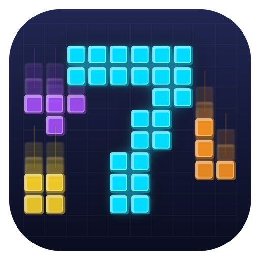

# DROP the SEVEN (DP7)

DP7은 JavaFX로 만든 테트리스 게임입니다. 일반·아이템 모드를 혼자 플레이하거나, 한 PC에서 로컬 대전을 하고 두 PC에서 P2P 대전을 할 수 있습니다.

## 다운로드

Java를 설치하지 않아도 바로 실행할 수 있습니다.

| OS | 다운로드 | 아이콘 |
|---|---|:---:|
| Windows | [DP7-windows.zip](https://github.com/SE-team7/tetris/releases/latest/download/DP7-windows.zip) | <a href="https://github.com/SE-team7/tetris/releases/latest/download/DP7-windows.zip"></a> |
| macOS | [DP7-mac.zip](https://github.com/SE-team7/tetris/releases/latest/download/DP7-mac.zip) | <a href="https://github.com/SE-team7/tetris/releases/latest/download/DP7-mac.zip"></a> |

릴리스 노트와 버전 기록은 [Releases](https://github.com/SE-team7/tetris/releases)에서 확인할 수 있습니다.

### Windows

1. `DP7-windows.zip`을 다운로드하고 압축을 풉니다.
2. `DP7` 폴더 안의 `DP7.exe`를 실행합니다.
   - "Windows의 PC 보호" 창이 뜨면 **추가 정보 → 실행**을 누릅니다.

> `DP7.exe`만 따로 꺼내면 실행되지 않습니다. `app/`, `runtime/` 폴더와 같은 위치에 있어야 합니다.

### macOS

1. `DP7-mac.zip`을 다운로드하고 압축을 풉니다.
2. `DP7.app`을 **우클릭 → 열기**로 실행합니다.
   - 그래도 막히면 **시스템 설정 → 개인정보 보호 및 보안 → 그래도 열기**를 누릅니다.

---

## 게임 모드

| 플레이 방식 | 선택 가능한 모드 |
|---|---|
| 싱글 플레이 | 일반, 아이템 |
| 로컬 2인 대전 | 일반, 아이템, 시간제한 |
| P2P 1:1 대전 | 일반, 아이템, 시간제한 |

- **일반 모드**에서는 가로줄을 채워 지우고 점수를 얻습니다.
- **아이템 모드**에서는 누적 10줄을 지울 때마다 아이템 블록이 생성 대기열에 추가됩니다. 아이템은 무게추, 줄 삭제, 폭탄, 십자가, 빈칸 파괴의 다섯 종류입니다.
- **대전**에서는 여러 줄을 한 번에 지워 상대에게 공격 줄을 보낼 수 있습니다. **시간제한 모드**에서는 3분, 5분, 10분 중 하나를 선택하며, 시간이 끝나면 점수로 승패를 결정합니다.
- **스코어보드**는 싱글 플레이의 일반·아이템 모드별로 10위까지 기록합니다. 10위와 동점인 기록도 보관합니다.

### 기본 조작

**설정**에서 난이도, 창 크기, 라이트·다크 테마, 색맹 모드, 조작키를 바꿀 수 있습니다. 싱글 플레이와 P2P는 같은 키 설정을 쓰며, 로컬 대전은 1P와 2P의 키를 각각 설정합니다.

### P2P 대전 시작

1. 두 플레이어가 메인 메뉴에서 **P2P 대전 모드 시작**을 선택합니다.
2. 호스트는 **서버 만들기**를 선택하고, 대기 화면에 표시된 주소를 상대에게 알려줍니다.
3. 참가자는 **서버 접속**에서 호스트 주소를 입력하거나 최근 접속 주소를 선택합니다. 연결에는 TCP `7777` 포트를 사용합니다.
4. 연결되면 호스트가 모드를 선택합니다. 시간제한 모드에서는 제한시간도 선택합니다.
5. 두 플레이어가 모두 **게임 시작**을 누르면 대전이 시작됩니다.

### 로컬 저장 데이터

설정과 기록은 사용자 홈의 `.tetris/` 폴더에 저장됩니다.

| 파일 | 내용 |
|---|---|
| `settings.properties` | 화면, 난이도, 조작키 설정 |
| `scoreboard.csv` | 모드별 싱글 플레이 기록 |
| `recent_hosts.txt` | 최근 접속한 P2P 호스트 주소 |

## 개발 환경

| 항목 | 설정 |
|---|---|
| Java | JDK 21 (Gradle Java Toolchain) |
| JavaFX | 21 (`javafx.controls`, `javafx.fxml`) |
| 빌드 | Gradle Wrapper 9.2.0 |
| 테스트 | JUnit Jupiter 5.12.1, JaCoCo 커버리지 |
| 의존성 저장소 | Maven Central |

## 빌드 및 테스트

| 작업 | Windows (PowerShell) | macOS |
|---|---|---|
| 전체 빌드 (테스트 포함) | `.\gradlew.bat clean build` | `./gradlew clean build` |
| 테스트 실행 | `.\gradlew.bat test` | `./gradlew test` |
| 테스트 및 커버리지 보고서 생성 | `.\gradlew.bat jacocoTestReport` | `./gradlew jacocoTestReport` |

테스트 코드는 `app/src/test/java/com/team/tetris/`에 있습니다. 

- 테스트 결과는 `app/build/reports/tests/test/index.html`에서 확인할 수 있습니다.

## 프로젝트 구조

```text
tetris/
├── app/
│   ├── build.gradle
│   └── src/
│       └── main/
│           ├── java/com/team/tetris/
│           │   ├── controller/
│           │   │   ├── BattleController.java
│           │   │   ├── BattleModeController.java
│           │   │   ├── BattleTypeController.java
│           │   │   ├── GameController.java
│           │   │   ├── GameOverController.java
│           │   │   ├── MainMenuController.java
│           │   │   ├── NetworkController.java
│           │   │   ├── P2PConnectionController.java
│           │   │   ├── P2PWaitingController.java
│           │   │   ├── ScoreboardController.java
│           │   │   ├── ScoreboardMenu.java
│           │   │   ├── SettingsController.java
│           │   │   └── TimeLimitController.java
│           │   ├── domain/
│           │   │   ├── AttackQueue.java
│           │   │   ├── AttackRows.java
│           │   │   ├── BattleConfig.java
│           │   │   ├── BattleEndReason.java
│           │   │   ├── BattleMode.java
│           │   │   ├── BattleResult.java
│           │   │   ├── BattleState.java
│           │   │   ├── Block.java
│           │   │   ├── BlockType.java
│           │   │   ├── Board.java
│           │   │   ├── ClearResult.java
│           │   │   ├── Difficulty.java
│           │   │   ├── GameMode.java
│           │   │   ├── GameSnapshot.java
│           │   │   ├── ItemType.java
│           │   │   ├── PlayerId.java
│           │   │   ├── Position.java
│           │   │   ├── Score.java
│           │   │   └── Settings.java
│           │   ├── Launcher.java
│           │   ├── Main.java
│           │   ├── network/
│           │   │   ├── BattleGateway.java
│           │   │   ├── BattleServiceGateway.java
│           │   │   ├── HostAddress.java
│           │   │   ├── MessageCodec.java
│           │   │   ├── MessagePayload.java
│           │   │   ├── MessageType.java
│           │   │   ├── NetworkEvents.java
│           │   │   ├── NetworkListener.java
│           │   │   ├── NetworkMessage.java
│           │   │   ├── NetworkService.java
│           │   │   ├── PayloadMapper.java
│           │   │   └── RecentHostStore.java
│           │   ├── service/
│           │   │   ├── AttackService.java
│           │   │   ├── BattleService.java
│           │   │   ├── BlockFactory.java
│           │   │   ├── GameEngineService.java
│           │   │   ├── item/
│           │   │   │   ├── BombEffect.java
│           │   │   │   ├── CrossEffect.java
│           │   │   │   ├── GapDestroyEffect.java
│           │   │   │   ├── ItemEffect.java
│           │   │   │   ├── LineClearEffect.java
│           │   │   │   └── WeightEffect.java
│           │   │   ├── LevelService.java
│           │   │   ├── ScoreboardService.java
│           │   │   ├── ScoreService.java
│           │   │   └── SettingsService.java
│           │   ├── util/
│           │   │   ├── FileManager.java
│           │   │   └── SceneManager.java
│           │   └── view/
│           │       ├── BattleModeView.java
│           │       ├── BattleTypeView.java
│           │       ├── BattleView.java
│           │       ├── GameOverView.java
│           │       ├── GameView.java
│           │       ├── MainMenuView.java
│           │       ├── P2PConnectionView.java
│           │       ├── P2PWaitingView.java
│           │       ├── ScoreboardView.java
│           │       ├── SettingsView.java
│           │       └── TimeLimitView.java
│           └── resources/
│               ├── icon/
│               │   ├── DP7.icns
│               │   ├── DP7.ico
│               │   └── DP7.png
│               ├── image/
│               │   └── item/
│               │       ├── bomb.png
│               │       ├── cross.png
│               │       ├── gapdestroy.png
│               │       ├── lineclear.png
│               │       └── weight.png
│               └── style.css
├── gradle/
│   ├── libs.versions.toml
│   └── wrapper/
│       ├── gradle-wrapper.jar
│       └── gradle-wrapper.properties
├── gradle.properties
├── gradlew
├── gradlew.bat
└── settings.gradle
```

| 패키지 | 역할 |
|---|---|
| `controller` | 사용자 입력과 화면별 게임 흐름 처리 |
| `domain` | 보드, 블록, 대전 상태, 점수, 설정 모델 정의 |
| `network` | TCP 연결, 메시지 인코딩·디코딩, 대전 데이터 변환 |
| `service` | 게임 진행, 대전, 공격, 레벨, 점수 및 설정 처리 |
| `service/item` | 아이템별 효과 구현 |
| `util` | 파일 저장과 JavaFX 화면 전환 |
| `view` | 게임, 대전, 설정, 스코어보드 화면 표시 |


## 배포

`jpackage`로 Java 런타임이 포함된 실행 파일을 만듭니다. 받는 사람은 Java를 설치하지 않아도 실행할 수 있습니다.

> `jpackage`는 **빌드하는 OS용 파일만** 만듭니다. Windows용은 Windows에서, macOS용은 macOS에서 빌드해야 합니다.

| 명령 | 결과 | 위치 |
|---|---|---|
| `packageApp` | 설치 없이 실행하는 앱 폴더 | `app/build/jpackage/` |
| `packageZip` | 위 앱 폴더를 묶은 zip (배포용) | `app/build/distributions/` |
| `packageInstaller` | 설치 파일 (Windows `exe`, macOS `dmg`) | `app/build/jpackage/` |

### Windows

```powershell
.\gradlew.bat packageZip
```

`app/build/distributions/DP7-<버전>-windows.zip`이 생성됩니다. 압축을 풀고 `DP7/DP7.exe`를 실행하면 됩니다.

설치 파일(`exe`)이 필요하면 [WiX Toolset 3](https://github.com/wixtoolset/wix3/releases)을 설치하고 PATH에 추가한 뒤 실행합니다.

```powershell
.\gradlew.bat packageInstaller
```

### macOS

```bash
./gradlew packageZip        # DP7-<버전>-mac.zip (DP7.app)
./gradlew packageInstaller  # DP7-<버전>.dmg
```

> `packageZip`으로 만든 zip은 실행 권한과 서명이 깨져 "손상됨" 오류가 납니다. 반드시 아래 방법으로 압축하세요.

```bash
./gradlew clean packageApp
cd app/build/jpackage
xattr -cr DP7.app
ditto -c -k --norsrc --noextattr --keepParent DP7.app DP7-mac.zip
```

서명되지 않은 앱이라 처음 실행할 때 경고가 뜨면, 앱을 우클릭 → **열기**로 실행합니다.

### GitHub Release로 배포

1. `app/build.gradle`의 `appVersion`을 올리고 Windows·macOS에서 각각 `packageZip`을 실행합니다.
2. 생성된 zip의 이름을 **`DP7-windows.zip`, `DP7-mac.zip`으로 변경**합니다.
   (README 다운로드 링크가 이 파일명을 사용하므로 버전이 바뀌어도 이름은 고정합니다.)
3. 최신 코드를 `main`에 push합니다.
4. GitHub **Releases → Draft a new release**
   - **Choose a tag**: 새 태그 입력(예: `v2.0`) 후 **Create new tag ... on publish** 클릭
   - **Target**: `main`
   - **Attach binaries** 영역(설명칸 아래)에 zip 두 개를 첨부
   - **Release label**: **Latest**
5. **Publish release**

| 태그 | 내용 |
|---|---|
| `v1.0` | 1차 요구사항 완료 |
| `v2.0` | 1·2차 요구사항 완료 |

### 이름·아이콘·버전 변경

- 이름·버전: `app/build.gradle`의 `appName`, `appVersion`
- 아이콘: `app/src/main/resources/icon/`의 `DP7.png`(게임 창), `.ico`(Windows), `.icns`(macOS)
- 창 제목·메인 메뉴 제목: `Main.java`의 `setTitle`, `MainMenuView.java`의 제목 `Label`

이름을 바꾸면 아이콘 파일 이름과 `Main.java`의 아이콘 경로도 같이 바꿔야 합니다.

> 게임 기록과 설정은 `{사용자 홈}/.tetris/`에 저장되므로, 새 버전을 배포해도 유지됩니다.
