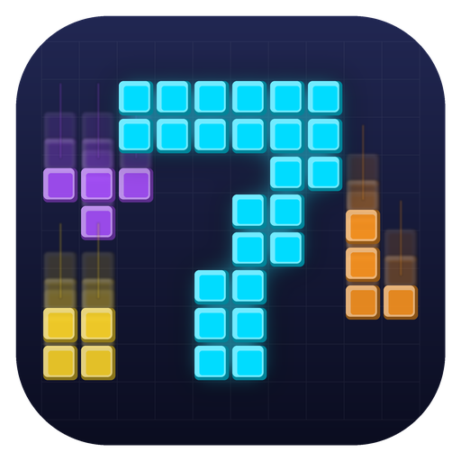

# Tetris 게임 개발

## 다운로드

Java를 설치하지 않아도 바로 실행할 수 있습니다.

| OS | 다운로드 | 아이콘 |
|---|---|:---:|
| Windows | [DP7-windows.zip](https://github.com/SE-team7/tetris/releases/latest/download/DP7-windows.zip) | <a href="https://github.com/SE-team7/tetris/releases/latest/download/DP7-windows.zip"></a> |
| macOS | [DP7-mac.zip](https://github.com/SE-team7/tetris/releases/latest/download/DP7-mac.zip) | <a href="https://github.com/SE-team7/tetris/releases/latest/download/DP7-mac.zip"></a> |

릴리스 노트와 버전 기록은 [Releases](https://github.com/SE-team7/tetris/releases)에서 확인할 수 있습니다.

### Windows

1. `DP7-windows.zip`을 다운로드하고 압축을 풉니다.
2. `DP7` 폴더 안의 `DP7.exe`를 실행합니다.
   - "Windows의 PC 보호" 창이 뜨면 **추가 정보 → 실행**을 누릅니다.

> `DP7.exe`만 따로 꺼내면 실행되지 않습니다. `app/`, `runtime/` 폴더와 같은 위치에 있어야 합니다.

### macOS

1. `DP7-mac.zip`을 다운로드하고 압축을 풉니다.
2. `DP7.app`을 **우클릭 → 열기**로 실행합니다.
   - 그래도 막히면 **시스템 설정 → 개인정보 보호 및 보안 → 그래도 열기**를 누릅니다.

---

## 개발 환경

- Java: JDK 21
- JavaFX: 21
- Build Tool: Gradle Wrapper
- Test: JUnit Jupiter
- IDE: VS Code
- 개발 OS: Windows / macOS

> 프로젝트는 Gradle Wrapper를 사용합니다. 팀원별로 별도의 Gradle 버전을 설치할 필요가 없습니다.
> JavaFX 의존성도 Gradle에서 관리하므로 JavaFX SDK를 별도로 다운로드하여 경로를 설정할 필요가 없습니다.

## 프로젝트 구조

```text
tetris/
├─ app/
│  ├─ build.gradle
│  └─ src/
│     ├─ main/
│     │  ├─ java/
│     │  │  └─ com/team/tetris/
│     │  │     └─ Main.java
│     │  └─ resources/
│     └─ test/
├─ gradle/
├─ gradle.properties
├─ gradlew
├─ gradlew.bat
└─ settings.gradle
```

`app`은 실제 테트리스 애플리케이션이 위치하는 Gradle 서브프로젝트

## 실행 전 준비

JDK 21 사용을 권장하며, 프로젝트 자체의 Java 버전은 Gradle Java Toolchain에서 21로 지정되어 있습니다.

## 실행 방법

저장소를 clone한 후 프로젝트 루트(`tetris`)에서 실행합니다.

### Windows

```powershell
.\gradlew.bat run
```

### macOS

최초 실행 시 필요하면 Gradle Wrapper에 실행 권한을 부여합니다.

```bash
chmod +x gradlew
./gradlew run
```

정상 실행되면 JavaFX 게임 창이 표시됩니다.

## 빌드

### Windows

```powershell
.\gradlew.bat clean build
```

### macOS

```bash
./gradlew clean build
```

## 테스트

### Windows

```powershell
.\gradlew.bat test
```

### macOS

```bash
./gradlew test
```

테스트 코드는 필요에 따라 다음 경로에 작성합니다.

```text
app/src/test/java/com/team/tetris/
```

## 개발 규칙

- 공통 개발 버전은 Java 21 / JavaFX 21을 사용합니다.
- Gradle 명령은 가급적 프로젝트에 포함된 Gradle Wrapper(`gradlew`, `gradlew.bat`)를 사용합니다.
- 개인 PC의 절대 경로(JAVA_HOME 경로 등)를 프로젝트 설정 파일에 작성하지 않습니다.
- 새로운 외부 라이브러리가 필요한 경우 `app/build.gradle`의 `dependencies`에 추가하고 팀에 공유합니다.
- `build/`, `.gradle/` 등 자동 생성 파일은 Git에 커밋하지 않습니다.
- 소스 코드와 리소스에서는 Windows/macOS에 종속적인 절대 경로 사용을 피합니다.

## 주요 Gradle 설정

현재 `app/build.gradle`에는 다음 공통 환경이 설정되어 있습니다.

- Java Toolchain 21
- JavaFX 21
  - `javafx.controls`
  - `javafx.fxml`
- JUnit Jupiter
- Maven Central
- Main Class: `com.team.tetris.Main`

## 배포

`jpackage`로 Java 런타임이 포함된 실행 파일을 만듭니다. 받는 사람은 Java를 설치하지 않아도 실행할 수 있습니다.

> `jpackage`는 **빌드하는 OS용 파일만** 만듭니다. Windows용은 Windows에서, macOS용은 macOS에서 빌드해야 합니다.

| 명령 | 결과 | 위치 |
|---|---|---|
| `packageApp` | 설치 없이 실행하는 앱 폴더 | `app/build/jpackage/` |
| `packageZip` | 위 앱 폴더를 묶은 zip (배포용) | `app/build/distributions/` |
| `packageInstaller` | 설치 파일 (Windows `exe`, macOS `dmg`) | `app/build/jpackage/` |

### Windows

```powershell
.\gradlew.bat packageZip
```

`app/build/distributions/DP7-<버전>-windows.zip`이 생성됩니다. 압축을 풀고 `DP7/DP7.exe`를 실행하면 됩니다.

설치 파일(`exe`)이 필요하면 [WiX Toolset 3](https://github.com/wixtoolset/wix3/releases)을 설치하고 PATH에 추가한 뒤 실행합니다.

```powershell
.\gradlew.bat packageInstaller
```

### macOS

```bash
./gradlew packageZip        # DP7-<버전>-mac.zip (DP7.app)
./gradlew packageInstaller  # DP7-<버전>.dmg
```

서명되지 않은 앱이라 처음 실행할 때 경고가 뜨면, 앱을 우클릭 → **열기**로 실행합니다.

### GitHub Release로 배포

1. `app/build.gradle`의 `appVersion`을 올리고 Windows·macOS에서 각각 `packageZip`을 실행합니다.
2. 생성된 zip의 이름을 **`DP7-windows.zip`, `DP7-mac.zip`으로 변경**합니다.
   (README 다운로드 링크가 이 파일명을 사용하므로 버전이 바뀌어도 이름은 고정합니다.)
3. 최신 코드를 `main`에 push합니다.
4. GitHub **Releases → Draft a new release**
   - **Choose a tag**: 새 태그 입력(예: `v2.0`) 후 **Create new tag ... on publish** 클릭
   - **Target**: `main`
   - **Attach binaries** 영역(설명칸 아래)에 zip 두 개를 첨부
   - **Release label**: **Latest**
5. **Publish release**

| 태그 | 내용 |
|---|---|
| `v1.0` | 1차 요구사항 완료 |
| `v2.0` | 1·2차 요구사항 완료 |

### 이름·아이콘·버전 변경

- 이름·버전: `app/build.gradle`의 `appName`, `appVersion`
- 아이콘: `app/src/main/resources/icon/`의 `DP7.png`(게임 창), `.ico`(Windows), `.icns`(macOS)
- 창 제목·메인 메뉴 제목: `Main.java`의 `setTitle`, `MainMenuView.java`의 제목 `Label`

이름을 바꾸면 아이콘 파일 이름과 `Main.java`의 아이콘 경로도 같이 바꿔야 합니다.

> 게임 기록과 설정은 `{사용자 홈}/.tetris/`에 저장되므로, 새 버전을 배포해도 유지됩니다.
